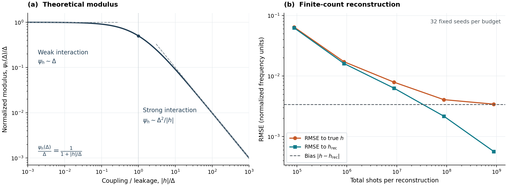

# What limits calibration

An interaction coefficient is a property of a physical generator, but an experiment observes that generator through its preparation and readout. When those surrounding operations are unknown, the observations can be compatible with more than one physical generator. The distinction matters even after fixing the canonical traceless-Pauli representation: the lower-bound models have different coherent interactions, not merely different notations for the same generator.

## 1. Why positivity creates a learnable boundary

For a positive Kossakowski matrix,

```math
|\alpha_{AB}|^2\le\alpha_{AA}\alpha_{BB}.
```

An unpopulated diagonal direction forces its entire row and column to vanish. Therefore, if every allowed pair with product $`C`$ has at least one zero diagonal rate, the dissipator cannot contribute to the Pauli-transfer sector of that interaction. The reciprocal responses then have opposite slopes proportional to the same $`h_C`$. Multiplying them and dividing by their zero-time gains recovers the signed coefficient.

This sufficient boundary condition is due to [FST2026](../references/RELATED_WORK.md). Its operational extension here is stable finite-data learning and a quantitative account of what happens when the zero rates become small positive rates.

For example, a $`ZZ`$ coupling with dissipative directions only in $`IX,IY,XI,YI`$ has $`\Delta_{ZZ}=0`$: no product of two populated labels is $`ZZ`$. Noise can still be substantial in those directions. The recovery condition concerns their product sector, not the total magnitude of dissipation.

## 2. Weak and resolved interactions

Write a reciprocal transfer block as

```math
T_{QP}=2(b+a),
\qquad T_{PQ}=-2(b-a).
```

The dissipative part can supply a symmetric component $`a`$ and can shift the antisymmetric component $`b`$. The gain-free estimate is

```math
\phi(b,a)=\operatorname{sgn}(b+a)\sqrt{(b^2-a^2)_+}.
```

When the interaction is resolved relative to the relevant noise, both slopes carry a consistent sign and

```math
|b|-\sqrt{b^2-a^2}
=\frac{a^2}{|b|+\sqrt{b^2-a^2}}.
```

The resulting bias is quadratic in the symmetric contamination. Averaging the blocks cancels their first-order antisymmetric contamination, and the local support correction removes exterior Hamiltonian shifts. These cancellations explain the scale $`\Delta_C^2/|h_C|`$.

For a weak coefficient, a slope may pass through zero and the reciprocal product may change sign. The square-root expression is then nonsmooth. The [uniform stability lemma](estimator.md#4-finite-data-stability-at-every-coupling-strength) shows that the physical constraints absorb this singularity into an $`O(\Delta_C)`$ error allowance, while sampling error remains additive. The crossover is summarized by

```math
\psi_h(\Delta)=\frac{\Delta^2}{|h|+\Delta}.
```



The first panel shows the dimensionless noise modulus, not an exact constant in a minimax risk. The second uses the committed finite-count data: statistical spread contracts around the reciprocal estimate while its offset from the physical coupling persists. Its horizontal line is this estimator's infinite-data bias, rather than an exact minimax constant. Figure generation is documented in [verification](../verification/README.md).

## 3. A physical ambiguity that more data cannot remove

The two-qubit lower family has diagonal rates $`\Gamma`$ and $`\eta`$, with a cross coefficient $`c`$ constrained by

```math
|c|\le2\sqrt{\Gamma\eta}.
```

A commuting product-depolarizing gauge changes the coherent and dissipative coefficients together:

```math
h'=h\cosh\theta+c\sinh\theta,
\qquad
c'=c\cosh\theta+h\sinh\theta.
```

Physical preparation and readout channels can absorb that same gauge. The full outcome law of every allowed controlled experiment is unchanged. The preserved combination $`h^2-c^2`$ explains the reciprocal statistic; the complete channel similarity proves the stronger indistinguishability claim.

For fixed strong diagonal rate $`\Gamma`$ and weak rate $`\eta`$, the worst-case Hamiltonian gap scales as

```math
\frac{\Gamma\eta}{|h|+\sqrt{\Gamma\eta}}.
```

At weak interaction it can be of order $`\sqrt{\Gamma\eta}`$. At a fixed nonzero interaction, it is of order $`\eta`$. The positivity-limited offdiagonal noise itself is already of order $`\sqrt{\Gamma\eta}`$; the latter regime is a quadratic improvement relative to that scale.

The lower bound concerns worst-case uncertainty over the model class, including unknown SPAM. It does not assert that every device with the same diagonal rates has that uncertainty. Known extra noise structure, calibrated intermediate operations, or accurate preparation/readout can supply information absent from this model.

## 4. Why local correction matters

Suppose $`C=Z_1Z_2`$ is contained in patches $`123`$ and $`124`$. A common exterior Pauli in an imaginary dissipative pair can appear as a Hamiltonian shift when the exterior is traced out. The three measured local coefficients can therefore have the form

```math
f(\varnothing)=h_C+x_3+x_4,
\qquad f(\{3\})=h_C+x_4,
\qquad f(\{4\})=h_C+x_3.
```

Their combination $`f(\{3\})+f(\{4\})-f(\varnothing)`$ recovers the global coefficient. The construction uses only three-qubit probes, even though the union of the patches has four qubits. The general [support formula](local_reconstruction.md) applies this cancellation without requiring stronger visibility on that union.

This is consequential for the error law. Individual spectator shifts can be first order in the noise scale; omitting their correction would lose the resolved-interaction improvement. The finite four-qubit example explicitly checks this cancellation.

## 5. What the experiment demonstrates

The finite-count example uses $`h=0.3`$, $`c=0.045`$, $`\Gamma=0.03`$ and $`\eta=0.02`$, with unknown preparation/readout gains. Its infinite-data reciprocal value is

```math
\sqrt{h^2-c^2}\simeq0.2966058,
```

so its physical offset is approximately $`0.0033942`$. The actual estimator receives sampled signed parities and estimates the zero-time gains from separate counts. Increasing the repetition budget reduces its statistical spread around the reciprocal value, rather than making that value equal the true $`h`$.

The largest recorded budget is 880 million shot equivalents per reconstruction. This illustrates the distinction between a scalable asymptotic guarantee and a practical resource estimate. Fixed locality, visibility and accuracy constants can be expensive. The [resource theorem](resources.md) and the [numerical account](../verification/README.md) expose those costs separately.

The proof's noise scale uses true diagonal rates. A separate statistical analysis is needed to convert uncertain estimates of very small rates into optimally narrow confidence regions. That extension is not needed for the stated estimator guarantee or physical ambiguity theorem.
